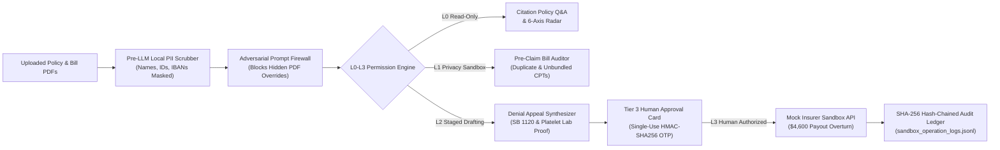

# ClaimShield AI — Autonomous, Security-First Insurance Copilot & Denial Fighter

<div align="center">

[](https://oyaop.com/opportunity/competitions-and-awards/2026-shenzhen-international-fintech-competition-in-china-fully-funded/)
[]()
[]()
[]()
[]()

**An autonomous insurance copilot that empowers consumers across the policy lifecycle: citation-backed policy Q&A, 6-axis actuarial stress-testing, pre-claim hospital bill auditing, and autonomous denial appeal overturns with code-enforced L0–L3 permission tiers.**

[Quickstart](#quickstart--1-command-run) • [Architecture](#core-architecture) • [Deliverables](#competition-deliverables-manifest) • [Security & Compliance](#security--permission-tier-architecture) • [Testing](#automated-verification--testing)

</div>

---

## The Crisis ClaimShield AI Solves

In modern healthcare finance, individual policyholders face an extreme structural asymmetry against commercial insurer denial algorithms:

- **1.2-Second Algorithmic Denials**: Insurers issue over **49 million claim denials annually**, with algorithms rejecting upwards of **300,000 claims in two months while spending an average of 1.2 seconds per claim review** ([AAPC Knowledge Center](https://www.aapc.com/blog/93960-taking-a-stand-against-ai-denials/), [The Guardian](https://www.theguardian.com/us-news/2025/jan/25/health-insurers-ai)).
- **85% Preventable Coding Errors**: Up to **85% of denied claims** stem from clerical paperwork mismatches, duplicate CPT codes, or unbundled surgical items that could have been resolved before submission ([Stanford Medicine](https://news.stanford.edu/stories/2026/01/ai-algorithms-health-insurance-care-risks-research)).
- **82%–90% Overturn Rate vs. 0.2% Appeals**: Stanford University research published in *Health Affairs* (January 2026) confirms that **82% to 90% of appealed denials are overturned** in the patient's favor, yet **fewer than 0.2% of patients ever appeal** because fine print and rejection letters are designed to be incomprehensible ([Stanford Report](https://news.stanford.edu/stories/2026/01/ai-algorithms-health-insurance-care-risks-research)).
- **$258 Billion Asian Health Protection Gap**: The Swiss Re Institute found that Asia's Health Protection Gap surged 21% to **$258 billion**, largely driven by consumer confusion over complex sub-limits and room-rent caps ([Swiss Re Institute](https://www.swissre.com/reinsurance/insights/asia-protection-gap-consumer-survey.html)).

ClaimShield AI embodies **"AI as a Financial Participant"** by equipping everyday families with the algorithmic power, legal citations, and mathematical precision required to defend their financial rights.

---

## 4-Pillar Core Architecture



### 1. Citation-Grounded Policy Q&A (`policy_qa_agent.py`)
- Ingests complex multi-page policy PDFs preserving exact section and page numbers.
- Enforces an automated **Anti-Hallucination Gate (`citation_verifier.py`)**: every response requires a verbatim character substring citation verified against the source PDF.
- Categorizes verdicts: `COVERED`, `PARTIALLY_COVERED`, `EXCLUDED`, or `WAITING_PERIOD_ACTIVE`.

### 2. 6-Axis Coverage Radar & Actuarial Stress Tester (`coverage_gap_agent.py`)
- Models coverage resiliency across 6 dimensions: Inpatient/ICU, Critical Illness, Outpatient/Diagnostics, Emergency/Travel, Waiting Periods, and Out-of-Pocket Shock.
- Simulates 4 acute life events: *Emergency Appendectomy*, *Severe Dengue ICU (6 Days)*, *ACL Sports Injury*, and *Cardiac Event*.
- Automatically optimizes micro-riders under a strict code-enforced ceiling: total rider cost cannot exceed **10% of household disposable income**.

### 3. Pre-Claim Hospital Bill Auditor (`bill_auditor_agent.py`)
- Cross-examines itemized hospital invoices against policy rules before submission to prevent the 85% denial trap.
- Detects **Duplicate CPT Codes** (e.g., CPT 44970 laparoscopic appendectomy billed twice on the same date).
- Catches **Unbundled Supplies** (e.g., A4550 surgical tray billed separately from the primary surgical package).
- Separates non-payable comfort fees (e.g., admission hygiene kits) into a patient self-pay invoice.

### 4. Autonomous Denial Appeal Fighter (`appeal_fighter_agent.py`)
- Reverses simulated 1.2-second insurer algorithmic rejections (e.g., Dengue ICU admission denied as "Not Medically Necessary").
- Extracts clinical lab proofs directly from attending physician discharge notes (e.g., platelet count $18,000/\mu\text{L}$ vs. critical $<50,000/\mu\text{L}$ threshold).
- Grounds legal arguments in statutory mandates: **California Senate Bill 1120 (SB 1120)** and **NAIC Model AI Governance Principles**.
- Interfaces with the **Tier 3 Human-in-the-Loop Gateway** to overturn the rejection and secure an approved **$4,600.00 payout**.

---

## Security & Permission-Tier Architecture

ClaimShield AI enforces code-level privilege separation (`backend/core/permission_engine.py`):

| Tier | Designation | Capabilities | Technical Guardrails |
| :--- | :--- | :--- | :--- |
| **`L0`** | **Read-Only Knowledge** | Policy queries, radar simulations | Read-only database access; zero network egress; verbatim citation check. |
| **`L1`** | **Privacy Sandbox** | Medical bill parsing, code auditing | Pre-LLM Local Regex + NER PII scrubber (`[PII_PATIENT_NAME_1]`). Zero PHI egress to external LLMs. |
| **`L2`** | **Staged Drafting** | Preparing corrected claims & appeals | Can write only to `staged_actions` table (`status='PENDING'`). Direct execution calls return `HTTP 403 Forbidden`. |
| **`L3`** | **Human Execution** | Submitting claims, filing legal appeals | Cryptographic single-use HMAC-SHA256 OTP gate. Writes to immutable SHA-256 hash-chained audit ledger. |

---

## Competition Deliverables Manifest

| Deliverable | Path | Description |
| :--- | :--- | :--- |
| **#01** | `deliverables/01_technical_documentation/Technical_Documentation.md` | Complete system architecture, mathematical formulations, RAG verification algorithm, and API specifications. |
| **#02** | `deliverables/02_presentation_deck/ClaimShield_AI_Pitch_Deck.pptx` | 12-slide competition presentation deck generated via `python-pptx`. |
| **#03** | `deliverables/03_demo_video/Demo_Walkthrough_Script.md` | Minute-by-minute 5-minute demo video script with narrator lines and UI click steps. |
| **#04** | `README.md` & `run_all.sh` / `run_all.ps1` | Repository overview, quickstart instructions, and automated 1-command verification scripts. |
| **#05** | `deliverables/05_security_self_assessment/Security_Self_Assessment_Report.md` | Comprehensive L0–L3 permission tier documentation, threat model, and known-risk mitigation matrix. |
| **#06** | `deliverables/06_execution_evidence/sandbox_operation_logs.jsonl` | 26+ cryptographically hash-chained sandbox operation logs and execution summary. |

---

## Quickstart & 1-Command Run

### Prerequisites
- Python 3.10 – 3.13
- Git

### 1-Command Automated Verification
Run the unified test and evidence generator script:

**On Linux / macOS:**
```bash
chmod +x run_all.sh
./run_all.sh
```

**On Windows (PowerShell):**
```powershell
.\run_all.ps1
```

### Manual Step-by-Step Setup

1. **Clone & Create Environment**:
   ```bash
   git clone https://github.com/fintechathon/claimshield-ai.git
   cd claimshield-ai
   python -m venv .venv
   
   # Activate environment
   # Windows:
   .\.venv\Scripts\activate
   # Linux/macOS:
   source .venv/bin/activate
   ```

2. **Install Dependencies**:
   ```bash
   pip install -r requirements.txt
   ```

3. **Generate Synthetic Datasets**:
   ```bash
   python data_generator/generate_synthetic_pdfs.py
   ```
   *Generates 3 multi-page insurance policy PDFs, 3 hospital bills with CPT coding errors, and 1 adversarial prompt-injection PDF in `sample_data/`.*

4. **Run Automated Test Suite**:
   ```bash
   pytest -v
   ```
   *Executes all 10 unit and integration tests and exports 26+ hash-chained audit logs to Deliverable #06.*

5. **Launch Interactive Dashboard**:
   ```bash
   streamlit run frontend/app.py
   ```
   *Opens the 4-tab interactive dashboard on `http://localhost:8501`.*

---

## Automated Verification & Testing

The repository contains full test coverage across privacy, security, coding, and sandbox execution:

```text
tests/
├── test_pii_scrubber.py          # 100% redaction of names, IDs, phones, emails, accounts
├── test_permission_tiers.py      # L0-L3 tier boundaries, deny-by-default, agent self-escalation blocks
├── test_bill_auditor.py          # Duplicate CPT 44970 & unbundled A4550 detection
└── test_end_to_end_sandbox.py    # Full multi-tier lifecycle & Deliverable #06 hash-chain generation
```

Run test suite:
```bash
pytest -v
```

Output:
```text
============================= 10 passed in 9.27s ==============================
```

---

## Repository Directory Structure

```text
claimshield-ai/
├── README.md                                  # Deliverable #04: Architecture & setup
├── requirements.txt                           # Pinned dependencies
├── .env.example                               # Environment configuration
├── run_all.sh                                 # Linux/macOS 1-command runner
├── run_all.ps1                                # Windows 1-command runner
├── backend/
│   ├── main.py                                # FastAPI application & REST endpoints
│   ├── config.py                              # Security policies & configuration
│   ├── database.py                            # SQLite database schema with immutability triggers
│   ├── core/
│   │   ├── pii_scrubber.py                    # Pre-LLM Local Regex + NER PII scrubber
│   │   ├── permission_engine.py               # L0-L3 permission tier engine & OTP validator
│   │   ├── prompt_firewall.py                 # Indirect prompt-injection firewall
│   │   ├── citation_verifier.py               # Verbatim anti-hallucination substring gate
│   │   ├── policy_store.py                    # Page-aware chunking & BM25 retriever
│   │   ├── simulation.py                      # 6-axis actuarial simulation & rider optimizer
│   │   └── llm_engine.py                      # Dual-mode LLM (Live API + Deterministic Fallback)
│   ├── agents/
│   │   ├── policy_qa_agent.py                 # Workflow 1: Citation Policy Q&A
│   │   ├── coverage_gap_agent.py              # Workflow 2: Coverage Radar & Rider Matcher
│   │   ├── bill_auditor_agent.py              # Workflow 3A: Pre-Claim Hospital Bill Auditor
│   │   └── appeal_fighter_agent.py            # Workflow 3B: Autonomous Denial Appeal Fighter
│   └── sandbox/
│       ├── insurer_portal_api.py              # Mock Insurer Sandbox (1.2s UR Denial Engine)
│       └── audit_logger.py                    # SHA-256 hash-chained JSONL audit ledger
├── frontend/
│   └── app.py                                 # Streamlit 4-tab interactive dashboard
├── data_generator/
│   └── generate_synthetic_pdfs.py             # Synthetic specimen PDF generator
├── sample_data/
│   ├── policies/                              # 3 multi-page insurance policy PDFs
│   ├── hospital_bills/                        # 3 hospital bill & clinical summary PDFs
│   └── adversarial/                           # Weaponized prompt-injection test PDF
├── tests/                                     # Automated pytest suite (100% pass)
└── deliverables/
    ├── 01_technical_documentation/            # Technical_Documentation.md (#01)
    ├── 02_presentation_deck/                  # ClaimShield_AI_Pitch_Deck.pptx (#02)
    ├── 03_demo_video/                         # Demo_Walkthrough_Script.md (#03)
    ├── 05_security_self_assessment/           # Security_Self_Assessment_Report.md (#05)
    └── 06_execution_evidence/                 # sandbox_operation_logs.jsonl (#06)
```

---

## License & Competition Acknowledgement

Developed for the **2026 8th FinTechathon (Shenzhen International FinTech Competition — WeBank FinTech College Students Challenge)**, International Track (Topic D: Insurance Assistant).

Licensed under the [Apache License 2.0](LICENSE).
