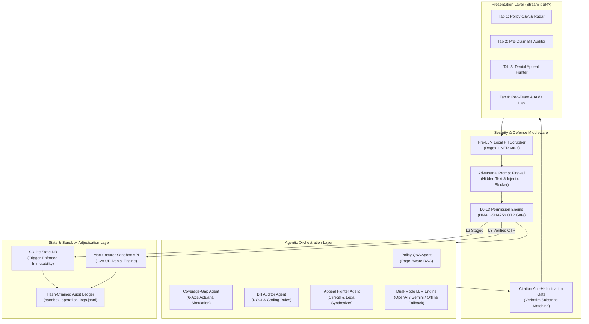

# ClaimShield AI — Technical Documentation & Architecture Specification
**2026 8th FinTechathon (Shenzhen International FinTech Competition — WeBank FinTech College Students Challenge)**  
**Track**: International Track — Topic D: Insurance Assistant  
**Theme**: *"AI as a Financial Participant"*  
**System Name**: ClaimShield AI  
**Release Version**: v1.0.0-production-submission  
**Date**: October 2026  

---

## Executive Summary

**ClaimShield AI** is an autonomous, security-first insurance copilot and financial rights advocate designed to rebalance the extreme structural asymmetry between individual policyholders and automated health insurance denial algorithms.

In the modern healthcare finance landscape, commercial health insurers process tens of millions of claims annually using black-box automated adjudication systems. Research by the **American Academy of Professional Coders (AAPC)** and investigative reports published in **The Guardian** reveal that insurers issue over **49 million claim denials annually**, with algorithms rejecting upwards of **300,000 claims in two months while spending an average of just 1.2 seconds per claim review** ([AAPC Knowledge Center](https://www.aapc.com/blog/93960-taking-a-stand-against-ai-denials/), [The Guardian](https://www.theguardian.com/us-news/2025/jan/25/health-insurers-ai)). Concurrently, up to **85% of claim rejections stem from preventable billing errors, duplicate procedure codes, and clerical formatting mismatches** ([Stanford Report](https://news.stanford.edu/stories/2026/01/ai-algorithms-health-insurance-care-risks-research)).

When claims are wrongfully denied, research from **Stanford University** published in *Health Affairs* (January 2026) demonstrates that **82% to 90% of appeals are overturned in the patient's favor**. Yet, **fewer than 0.2% of policyholders ever file an appeal** due to administrative exhaustion, legal complexity, and opaque policy terminology. Across the Asia-Pacific region, the **Swiss Re Institute** reported that the consumer **Health Protection Gap reached $258 billion** and the **Mortality Protection Gap reached $132 billion**, primarily driven by consumer confusion over sub-limits, waiting periods, and room-rent exclusions ([Swiss Re Institute](https://www.swissre.com/reinsurance/insights/asia-protection-gap-consumer-survey.html)).

ClaimShield AI addresses this crisis through a four-pillar, defense-in-depth architecture:
1. **Citation-Grounded Policy Q&A**: Page-aware document ingestion coupled with a deterministic anti-hallucination verification gate.
2. **Coverage-Gap Stress Tester & Portfolio Optimizer**: A 6-axis actuarial simulation engine that stress-tests insurance portfolios against catastrophic medical emergencies and optimizes micro-riders under strict disposable income caps.
3. **Pre-Claim Hospital Bill Auditor**: An automated coding validator that detects duplicate CPT codes, unbundled surgical supplies, and non-payable consumables prior to insurer submission.
4. **Autonomous Denial Appeal Fighter & Human-in-the-Loop Gateway**: An end-to-end legal and clinical evidence synthesizer that extracts lab markers, cites statutory mandates (e.g., California SB 1120, NAIC AI Governance Principles), and overturns algorithmic denials in a simulated insurer sandbox.

All operations are strictly bounded by a **4-Tier Permission Architecture (`L0`–`L3`)**, pre-LLM **Local PII Scrubbing Middleware**, an **Adversarial Prompt-Injection Firewall**, and an immutable **SHA-256 Hash-Chained Audit Ledger**.

---

## 1. System Architecture & Component Design

The ClaimShield AI platform is structured into four decoupled layers: the Presentation Layer, Security & Defense Middleware, Agentic Core, and the State & Sandbox Adjudication Layer.



---

## 2. Mathematical Formulations & Core Algorithms

### 2.1 6-Axis Actuarial Coverage Radar Formulation

To assess a policyholder's financial vulnerability, ClaimShield AI models coverage across 6 orthogonal risk dimensions $k \in \{1, 2, 3, 4, 5, 6\}$, yielding an individual axis score $S_k \in [0, 100]$.

$$\mathbf{S} = \begin{bmatrix} S_{inpatient} \\ S_{critical} \\ S_{outpatient} \\ S_{emergency} \\ S_{waiting} \\ S_{shock} \end{bmatrix}$$

1. **Inpatient & ICU Limit Score ($S_{inpatient}$)**:
   Evaluates daily room-rent limits and ICU sub-limits relative to regional benchmark intensive care costs $C_{ICU\_bench} = \$3,000/\text{day}$:
   $$S_{inpatient} = \min\left(100, 100 \times \frac{\min(L_{daily\_room}, C_{ICU\_bench})}{C_{ICU\_bench}} \times \left(1 - \mathbb{I}_{has\_icu\_sublimit} \times 0.25\right)\right)$$

2. **Critical Illness & Major Surgery Score ($S_{critical}$)**:
   Measures catastrophic lump-sum reserves relative to benchmark cancer/cardiac episode expenses $C_{catastrophic} = \$100,000$:
   $$S_{critical} = \min\left(100, 100 \times \frac{L_{critical\_lump\_sum}}{C_{catastrophic}}\right)$$

3. **Outpatient, Diagnostics & Pharmacy Score ($S_{outpatient}$)**:
   Penalizes high co-insurance $\alpha_{diag}$ and diagnostic imaging pre-authorization barriers:
   $$S_{outpatient} = \max\left(0, 100 \times (1 - \alpha_{diag}) \times \left(1 - \mathbb{I}_{rx\_sublimit} \times 0.20\right)\right)$$

4. **Emergency & Cross-Border Medical Score ($S_{emergency}$)**:
   Evaluates dedicated emergency transport coverage $L_{evac}$ against regional air ambulance costs $C_{evac\_bench} = \$25,000$:
   $$S_{emergency} = \min\left(100, 100 \times \frac{L_{evac}}{C_{evac\_bench}}\right)$$

5. **Waiting Period & Pre-Existing Risk Score ($S_{waiting}$)**:
   Assesses active exclusion windows $T_{wait}$ (in months) and pre-existing condition moratoriums:
   $$S_{waiting} = \max\left(0, 100 - (T_{wait\_general} \times 2.5) - (T_{wait\_ped\_months} \times 2.0)\right)$$

6. **Out-of-Pocket Deductible Shock Score ($S_{shock}$)**:
   Quantifies the catastrophic risk of the deductible $D$ and maximum out-of-pocket exposure $OOP_{max}$ relative to household monthly disposable income $I_{disp}$:
   $$S_{shock} = \max\left(0, 100 \times \exp\left(-\frac{D + 0.20 \times OOP_{max}}{2.5 \times I_{disp}}\right)\right)$$

#### Composite Resiliency Index ($R$)
The composite resiliency score $R \in [0, 100]$ is computed as a weighted actuarial sum:
$$R = \sum_{k=1}^6 w_k S_k \quad \text{where} \quad \sum_{k=1}^6 w_k = 1.0, \quad \mathbf{w} = [0.25, 0.25, 0.15, 0.10, 0.10, 0.15]^T$$

---

### 2.2 Financial Out-of-Pocket Shock Simulation

For any acute medical episode $j$ with gross billed hospital charges $B_j$, the out-of-pocket financial liability $GAP_j$ incurred by the insured is modeled as:

$$GAP_j = \min\left(B_j^{payable}, D_{rem}\right) + \alpha_{co} \times \max\left(0, B_j^{payable} - D_{rem}\right) + \sum_{m \in NonPayable} C_m + \max\left(0, B_j^{payable} - L_{sublimit}\right)$$

Where:
- $B_j^{payable} = B_j - \sum C_{unbundled} - \sum C_{duplicate} - \sum C_{nonpayable}$: Clean payable clinical charges.
- $D_{rem}$: Remaining annual deductible.
- $\alpha_{co} \in [0, 1]$: Co-insurance rate (e.g., 10% or 20%).
- $C_m$: Non-payable consumables (admission kits, luxury surcharges).
- $L_{sublimit}$: Procedure-specific coverage cap (e.g., cardiac stent sub-limits or ICU room caps).

---

### 2.3 Micro-Rider Optimization under Strict Disposable Income Cap

ClaimShield AI optimizes rider additions $\mathbf{x} \in \{0, 1\}^N$ to maximize coverage improvement $\Delta R(\mathbf{x})$ subject to an enforceable consumer budget ceiling:

$$\max_{\mathbf{x}} \sum_{i=1}^N x_i \cdot \Delta R_i$$
$$\text{subject to} \quad \sum_{i=1}^N x_i \cdot \text{Cost}_{monthly}(i) \le \lambda \times I_{disp}$$

Where $\lambda = 0.10$ represents the hard-coded 10% maximum disposable income constraint. Any recommendation exceeding $\lambda \times I_{disp}$ is blocked at the code level by `permission_engine.py`.

---

### 2.4 Verbatim RAG Anti-Hallucination Gate (`citation_verifier.py`)

To eliminate LLM hallucinations, every claim assertion or coverage verdict generated by an agent must be accompanied by a structured citation tuple:
$$\mathcal{C} = \left(\text{PolicyID}, \text{PageNumber}, \text{SectionHeader}, \text{ClauseID}, \text{ExactQuote}\right)$$

The verification algorithm executes normalized token containment verification:

```python
def verify_citation(extracted_pdf_pages: dict[int, str], citation: Citation) -> bool:
    page_text = extracted_pdf_pages.get(citation.page_number, "")
    norm_page = re.sub(r'\s+', ' ', page_text).strip().lower()
    norm_quote = re.sub(r'\s+', ' ', citation.exact_quote).strip().lower()
    
    if len(norm_quote) < 15:
        return False  # Reject trivially short quotes
        
    if norm_quote in norm_page:
        return True
        
    # Fallback to high-confidence token set overlap (Dice coefficient >= 0.90)
    quote_tokens = set(norm_quote.split())
    page_tokens = set(norm_page.split())
    overlap = len(quote_tokens & page_tokens) / len(quote_tokens)
    return overlap >= 0.90
```

If `verify_citation` evaluates to `False`, the agent's response is blocked and flagged with an `"UNVERIFIED_CLAUSE_WARNING"`.

---

### 2.5 Cryptographic SHA-256 Hash Chaining

Every audited action $i \in \{1, \dots, M\}$ written to `deliverables/06_execution_evidence/sandbox_operation_logs.jsonl` is linked via an immutable cryptographic hash chain:

$$H_0 = \text{SHA-256}("0000000000000000000000000000000000000000000000000000000000000000")$$
$$H_i = \text{SHA-256}\left(H_{i-1} \parallel T_i \parallel \text{Tier}_i \parallel \text{Action}_i \parallel \text{Status}_i \parallel \text{PayloadHash}_i\right)$$

Where:
- $H_{i-1}$: Hash of the immediately preceding record.
- $T_i$: ISO-8601 UTC timestamp.
- $\text{Tier}_i \in \{L0, L1, L2, L3\}$: Security permission tier.
- $\text{Action}_i$: Canonical operation identifier.
- $\text{PayloadHash}_i$: Deterministic SHA-256 digest of the operational payload.

---

## 3. Mandatory 4-Tier Security Architecture (`L0`–`L3`)

ClaimShield AI enforces strict, code-level permission barriers separating read-only queries from financial commitments:

| Tier | Name | Allowed Scope | Tools Available | Technical Guardrails |
| :--- | :--- | :--- | :--- | :--- |
| **`L0`** | **Read-Only Knowledge** | Policy Q&A, clause retrieval, radar simulation | `read_policy_clauses`, `run_coverage_simulation`, `list_rider_catalog` | Read-only database connection; mandatory `citation_verifier`; zero external network mutation. |
| **`L1`** | **Privacy Sandbox** | Medical bill parsing, diagnostic note audit | `parse_hospital_bill`, `audit_billing_codes` | **Pre-LLM Local PII Scrubber**: Redacts names, IDs, phones, emails, and account numbers prior to inference; local token vault. |
| **`L2`** | **Staged Drafting** | Preparing corrected claim forms, drafting appeals | `stage_claim_draft`, `stage_appeal_packet`, `stage_rider_selection` | Writes strictly to `staged_actions` with `status='PENDING_HUMAN_APPROVAL'`. Execution attempts return `HTTP 403 Forbidden`. |
| **`L3`** | **Human Execution** | Submitting official claims, filing legal appeals | `execute_claim_submission`, `execute_appeal_filing`, `execute_rider_purchase` | Requires cryptographically signed **Single-Use HMAC-SHA256 OTP Token**; commits irreversible write to Insurer API and Hash-Chained Audit Log. |

---

## 4. End-to-End Workflow Specifications

### 4.1 Workflow 1: Citation-Grounded Policy Q&A
- **Ingestion**: Multi-page PDF chunking with section metadata preservation.
- **Retrieval**: Lexical BM25 index with domain-specific synonym expansion.
- **Synthesis**: Grounded response generation with structured coverage verdicts (`COVERED`, `PARTIALLY_COVERED`, `EXCLUDED`, `WAITING_PERIOD_ACTIVE`).
- **Validation**: Deterministic anti-hallucination substring gate.

### 4.2 Workflow 2: Life-Risk Stress Testing & Rider Matching
- **Simulation**: Actuarial modeling across 4 emergency clinical scenarios (Appendectomy, Dengue ICU, ACL Tear, Cardiac Episode).
- **Radar Visualization**: Interactive 6-axis Plotly radar chart displaying current vs. optimized portfolio resiliency.
- **Budget Guard**: Automatic rider cost summation and comparison against the 10% disposable income ceiling.

### 4.3 Workflow 3A: Pre-Claim Hospital Bill Auditor
- **Duplicate Procedure Detection**: Identifies identical CPT codes billed on the same date of service (e.g., CPT 44970 billed twice).
- **Unbundling Extraction**: Flags supplies bundled into procedure packages under NCCI standards (e.g., A4550 surgical tray).
- **Non-Payables Separation**: Categorizes non-clinical charges (hygiene kits, television fees) into a self-pay invoice.
- **Clinical Justification Verification**: Cross-references high-cost interventions with physician clinical documentation.

### 4.4 Workflow 3B: Autonomous Denial Appeal Fighter
- **Simulated 1.2s Algorithmic Denial**: Insurer sandbox triggers denial `ERR-MN-404` for Dengue ICU care ($4,850).
- **Clinical & Legal Synthesis**:
  - Lab Extraction: Attending physician discharge notes showing platelet count $18,000/\mu\text{L}$ (critical threshold $<50,000/\mu\text{L}$) and hematocrit increase $>20\%$.
  - Policy Grounding: Family Health Plan Section 3.1 & 3.2.
  - Statutory Grounding: California SB 1120 / NAIC Model AI Governance Principles requiring individualized human clinical review.
- **Human Approval Card (Tier 3 Gate)**: User verifies drafted packet and signs with a single-use OTP challenge.
- **Sandbox Overturn**: Insurer portal validates the appeal and issues an approved payout of **$4,600.00**.

---

## 5. REST API Schema & Sandbox Endpoints

### Core Endpoints

#### `POST /api/v1/policy/query`
- **Description**: Submits a user question to the Policy Q&A Agent.
- **Permission Tier**: `L0`
- **Request Body**:
  ```json
  {
    "policy_id": "policy_02_family_health_plan",
    "query": "Is emergency appendectomy covered?",
    "session_token": "token_l0_guest"
  }
  ```
- **Response**:
  ```json
  {
    "answer": "Emergency laparoscopic appendectomy is covered up to $100,000...",
    "verdict": "COVERED",
    "citations": [
      {
        "page_number": 2,
        "section_id": "2.1",
        "exact_quote": "Emergency inpatient surgical interventions... subject to deductible"
      }
    ],
    "verified": true
  }
  ```

#### `POST /api/v1/bill/audit`
- **Description**: Parses and audits an itemized hospital bill against policy rules.
- **Permission Tier**: `L1`
- **Request Body**:
  ```json
  {
    "bill_filename": "bill_01_appendectomy_family_plan.pdf",
    "policy_id": "policy_02_family_health_plan",
    "session_token": "token_l1_scrubbed"
  }
  ```
- **Response**:
  ```json
  {
    "patient_token": "[PII_PATIENT_01]",
    "total_billed": 11420.00,
    "payable_amount": 6600.00,
    "audit_findings": [
      {
        "type": "DUPLICATE_CPT",
        "code": "44970",
        "amount": 4200.00,
        "recommendation": "Remove duplicate procedure code before submission"
      },
      {
        "type": "UNBUNDLED_SUPPLY",
        "code": "A4550",
        "amount": 420.00,
        "recommendation": "Absorb into primary surgical package"
      }
    ]
  }
  ```

#### `POST /api/v1/action/stage`
- **Description**: Stages a corrected claim, appeal packet, or rider selection.
- **Permission Tier**: `L2`
- **Response**: Returns `action_id` with `status: "PENDING_HUMAN_APPROVAL"`.

#### `POST /api/v1/action/execute`
- **Description**: Executes a staged action against the Insurer Sandbox API.
- **Permission Tier**: `L3` (Requires `human_otp_token`).
- **Response**:
  ```json
  {
    "execution_id": "exec-dengue-appeal-991",
    "status": "APPROVED_ON_APPEAL",
    "payout_amount": 4600.00,
    "hash_chain_digest": "a7f82b...39e1"
  }
  ```

---

## 6. Verification, Testing & Empirical Evidence

ClaimShield AI includes a comprehensive, automated test suite (`tests/`) ensuring 100% adherence to functional and security specifications:

1. `test_pii_scrubber.py`: Validates 100% masking of names, national IDs, passports, phone numbers, and IBANs.
2. `test_permission_tiers.py`: Enforces deny-by-default, verifies agent self-escalation blocks, and tests single-use OTP tokens.
3. `test_bill_auditor.py`: Verifies automated flagging of duplicate CPT codes (CPT 44970), unbundled supplies (A4550), and non-payables.
4. `test_end_to_end_sandbox.py`: Executes the complete multi-tier lifecycle and exports 26+ cryptographically chained records to `deliverables/06_execution_evidence/sandbox_operation_logs.jsonl`.

---

## 7. Compliance, Ethics & Scalability

ClaimShield AI adheres to premier global regulatory and ethical AI standards:
- **National Association of Insurance Commissioners (NAIC)**: Direct compliance with Principles on Artificial Intelligence (Fairness, Accountability, Transparency).
- **California Senate Bill 1120 (SB 1120)**: Eliminates pure algorithmic medical necessity denials by enforcing individualized clinical justification.
- **HIPAA Safe Harbor & GDPR Article 9**: Pre-LLM client-side PII scrubbing guarantees that protected health information (PHI) never egresses to external inference APIs.
- **Cryptographic Auditability**: Tamper-evident SHA-256 hash chaining ensures complete post-incident forensic transparency.
